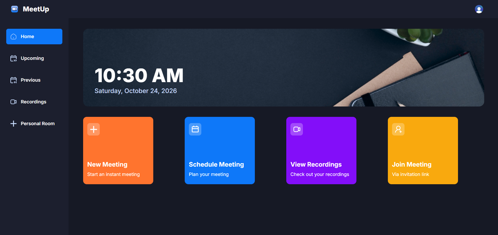

# Zoom Clone — Video Calling App

A full stack, real-time video calling app with built-in recording and user authentication, built with Next.js 14, Stream SDK, and Clerk.

**Live demo:** https://meetup-allanrs19.vercel.app


<!-- Add a screenshot of the main screen here and, if possible, a GIF of a call in progress -->

## Features

- Real-time video calls with low latency.
- Built-in recording: capture, store, and play back previous sessions.
- Authentication and session management with Clerk, with routes protected through middleware.
- Instant and scheduled meetings.
- Personal room and shareable links to invite participants.
- Upcoming and previous meetings lists.
- Responsive UI built with Tailwind CSS and shadcn/ui components.

## Tech Stack

| Area | Tools |
| --- | --- |
| Framework | Next.js 14 (App Router), React 18, TypeScript |
| Real-time video | Stream Video React SDK, Stream Node SDK |
| Authentication | Clerk |
| Styling and UI | Tailwind CSS, shadcn/ui, Radix UI, lucide-react |
| Deployment | Vercel |

## How It Works

1. Clerk authenticates the user and protects routes from `middleware.ts`.
2. A server action generates a Stream token for the signed-in user using the Stream Node SDK. [confirm the name and location in `actions/`]
3. The client connects to Stream through the React SDK and creates or joins a call.
4. Recordings are stored by Stream and listed so users can play them back later.

## Project Structure

```
actions/      Server actions (e.g., token generation)
app/          Routes and pages (App Router)
components/   UI and meeting components
constants/    Constants and navigation data
hooks/        Custom hooks
lib/          Utilities
providers/    Context providers (Stream client)
middleware.ts Route protection with Clerk
```

## Getting Started

**Prerequisites:** Node.js 18 or later, and free accounts on [Clerk](https://clerk.com) and [Stream](https://getstream.io).

```bash
git clone https://github.com/AllanRS19/zoom-clone.git
cd zoom-clone
npm install
```

Create a `.env.local` file in the project root:

```env
# Clerk
NEXT_PUBLIC_CLERK_PUBLISHABLE_KEY=
CLERK_SECRET_KEY=
NEXT_PUBLIC_CLERK_SIGN_IN_URL=/sign-in
NEXT_PUBLIC_CLERK_SIGN_UP_URL=/sign-up

# Stream
NEXT_PUBLIC_STREAM_API_KEY=
STREAM_SECRET_KEY=

# App base URL
NEXT_PUBLIC_BASE_URL=http://localhost:3000
```
<!-- Confirm these variable names by searching for "process.env" in your code -->

Start the development server:

```bash
npm run dev
```

Open [http://localhost:3000](http://localhost:3000) in your browser.

## Scripts

| Command | Description |
| --- | --- |
| `npm run dev` | Start the development server |
| `npm run build` | Create a production build |
| `npm run start` | Run the production build |
| `npm run lint` | Lint the code with ESLint |

## Deployment

Deployed on Vercel. To deploy your own copy, import the repo into Vercel and add the environment variables listed above.

## Author

**Allan Romero Solís** — [LinkedIn](https://www.linkedin.com/in/allan-romero/) · [Portfolio](https://allanromero.dev) · [GitHub](https://github.com/AllanRS19)